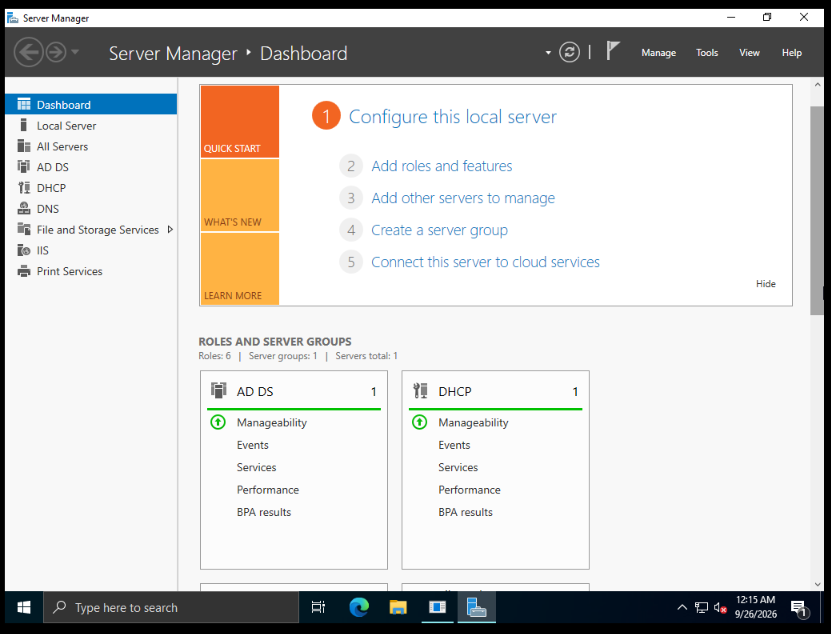

# Active Directory Domain Services (AD DS) Enterprise Lab

## Project Overview
This project demonstrates the deployment, configuration, and administration of an enterprise-grade **Active Directory Domain Services (AD DS)** environment using Windows Server. The lab covers core identity management, server role configuration (DNS & DHCP), and centralized administrative control.

---

## Architecture & Topology
- **Primary Domain Controller (DC):** Windows Server running AD DS, DNS, and DHCP roles[cite: 6].
- **Client Endpoints:** Windows 10/11 workstations joined to the domain.
- **Management Console:** Windows Server Manager Dashboard for real-time service monitoring and role management[cite: 6].

---

## Key Technologies & Tools
* **Operating System:** Windows Server 
* **Core Roles & Services:** AD DS (Active Directory Domain Services), DHCP Server, DNS Server[cite: 6]
* **Management Tools:** Server Manager Dashboard, Active Directory Users and Computers (ADUC)

---

## Key Implementations & Highlights

### 1. Server Roles & Core Services Deployment
- Configured and promoted the server as a Domain Controller (AD DS) to manage network identities[cite: 6].
- Deployed and configured **DHCP Server** and **DNS Server** roles for dynamic IP allocation and internal name resolution[cite: 6].

### 2. Identity & Access Management (IAM)
- Established organizational structures and user account security baselines within the domain environment.

---

## Lab Proof of Concept

### Server Manager Dashboard & Active Roles Overview
Displaying active server roles including AD DS and DHCP under the central management console:

---

## Key Takeaways & Skills Learned
* Practical deployment and configuration of core Windows Server infrastructure roles (AD DS, DHCP, DNS)[cite: 6].
* Proficiency in using the Server Manager Dashboard for enterprise service monitoring and management[cite: 6].
* Strong foundation in directory services, domain architecture, and system administration.
